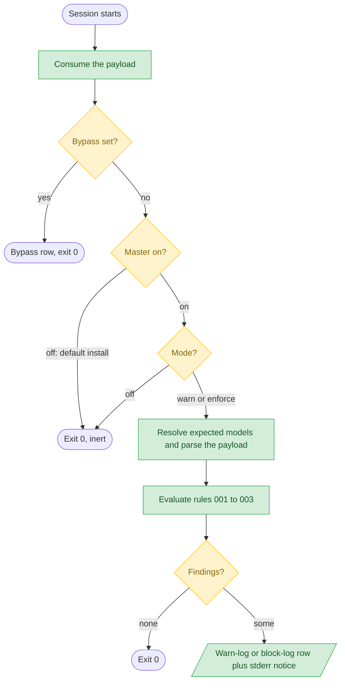

# Verify the session's model and effort posture at launch

## Summary

A SessionStart hook reads the launch payload once, walks the precedence chain (bypass variable, master gate, its own
mode file), resolves the expected model set from the canonical `[spoke_runtime]` surface, and evaluates three rules:
model mismatch, effort mismatch, and a degraded notice when the payload carries no model at all. Every path exits 0
in warn mode; findings go to a warn log and stderr, never into the model's context. The hook is a verifier, not a
gate: SessionStart hooks cannot stop a session. Its
[ICOM](/core/process-catalog/definitions/pack.json) table (inputs, controls, outputs, mechanisms)
follows.

## ICOM

| Inputs | Controls | Outputs | Mechanisms |
|---|---|---|---|
| The SessionStart payload on stdin (`source`, `model`, `effort.level`); `$CLAUDE_EFFORT`; the platform-config template and the operator's XDG `platform-config.toml`; the hook's own mode file | The master-activation gate (workflow class); the mode file `warn` default; the rule registry 001–003; the immutable effort directive `max` | A warn-log row per finding, a stderr notice per finding, a bypass-log row on bypass, exit 0 (warn) or 1 (enforce) | The hook script; `lib/master-enable.sh`; `lib/dep-resolve.sh` for `jq`; the settings template's SessionStart registration |

## Flow

## Steps

| Step | Action | Actor | Inputs → outputs (shape) | Controls | Mechanism | Harness | Model need | Source |
|---|---|---|---|---|---|---|---|---|
| consume-launch-payload | Read the SessionStart payload once | hook:verify-session-config | stdin JSON → `INPUT` string (empty on read failure) | fail-safe trap: every unexpected failure exits 0 | `cat` under `trap 'exit 0' ERR` | tool-event-hooks | XS/none/read/scriptable/batch | [hook](/core/hooks/verify-session-config.sh#L68)<!-- source-anchor: line=68; fp=f2815a84f8735011 -->, [hook](/core/hooks/verify-session-config.sh#L97)<!-- source-anchor: line=97; fp=8b074ad46dca3f88 --> |
| honor-bypass-escape | Exit on the bypass variable before any gate | hook:verify-session-config | `CLAUDE_HOOK_BYPASS=1` → bypass-log row, exit 0 | precedence layer 1 | `printf` append | tool-event-hooks | XS/none/write/scriptable/batch | [hook](/core/hooks/verify-session-config.sh#L99)<!-- source-anchor: line=99; fp=346da091bc6c04d0 --> |
| apply-master-gate | Apply the workflow-class master-activation gate | hook:verify-session-config | master state → exit 0 when off (shipped default), continue when on | C-074 to C-076: code-off | `master_enable_gate workflow` | tool-event-hooks | XS/none/read/scriptable/batch | [hook](/core/hooks/verify-session-config.sh#L107)<!-- source-anchor: line=107; fp=d49ce39d033db819 --> |
| read-mode-file | Read the hook's own mode file | hook:verify-session-config | `.verify-session-config-mode` (absent → `warn`; `off` → exit 0) → MODE | the installer lays down no mode file for this hook, so `warn` is the default the hook runs with | file read | tool-event-hooks | XS/none/read/scriptable/batch | [hook](/core/hooks/verify-session-config.sh#L116)<!-- source-anchor: line=116; fp=e9b02a09b406f076 --> |
| resolve-json-reader | Resolve `jq` through the shared dependency resolver | hook:verify-session-config | `lib/dep-resolve.sh` → `JQ` path or empty (empty makes the model unverifiable, never a fail-closed) | advisory posture: a missing `jq` degrades, never blocks | `resolve_jq` | tool-event-hooks | XS/none/read/scriptable/batch | [hook](/core/hooks/verify-session-config.sh#L127)<!-- source-anchor: line=127; fp=fe2631639bcf81a2 --> |
| resolve-expected-models | Read the accept set from the canonical config surface | hook:verify-session-config | template floor (`core/config/platform-config.toml.template`) then the XDG override → `default_spoke_model`, `chip_model`; `opus` when unresolved | no hardcoded model; consumer fallback per the resolver's Rule 2 | `_vsc_resolve_platform_config` | file-and-shell-tools | XS/none/read/scriptable/batch | [hook](/core/hooks/verify-session-config.sh#L138)<!-- source-anchor: line=138; fp=24623dbcb1c88a28 --> |
| parse-launch-payload | Extract source, model and effort | hook:verify-session-config | payload JSON → `resolved_source`, `resolved_model`, `payload_effort`; effort = `$CLAUDE_EFFORT`, else the payload | jq-guarded parse | `jq -r` | tool-event-hooks | XS/none/read/scriptable/batch | [hook](/core/hooks/verify-session-config.sh#L173)<!-- source-anchor: line=173; fp=deb046ce340cce29 --> |
| canonicalize-model-family | Reduce model ids and aliases to a family token | hook:verify-session-config | full model id → `opus`, `sonnet`, `haiku` or the lowercased id | version-stable comparison | `_vsc_family` | none | XS/none/none/scriptable/batch | [hook](/core/hooks/verify-session-config.sh#L189)<!-- source-anchor: line=189; fp=84deda771afd2f1d --> |
| evaluate-model-rule | Decide 003 (model absent) or 001 (family outside the accept set) | hook:verify-session-config | resolved family × accept set → finding `003` when `.model` is absent, `001` on mismatch, none otherwise | rule registry 001 and 003 | `add_finding` | none | XS/none/none/scriptable/batch | [hook](/core/hooks/verify-session-config.sh#L205)<!-- source-anchor: line=205; fp=44e6e38a71c5eab7 --> |
| evaluate-effort-rule | Decide 002 or the degraded effort advisory | hook:verify-session-config | effort token → `002` when not `max`; an unnumbered DEGRADED stderr line when no effort source exists | rule registry 002; the directive value is `max` | `add_finding` | none | XS/none/none/scriptable/batch | [hook](/core/hooks/verify-session-config.sh#L219)<!-- source-anchor: line=219; fp=c4f503c4583f7303 --> |
| emit-findings | Write each finding and exit | hook:verify-session-config | findings → warn: warn-log row + stderr `WARN`, exit 0; enforce: block-log row + stderr, exit 1; none: exit 0 | stderr only, never stdout (stdout enters the model's context) | `printf` append | tool-event-hooks | XS/none/write/scriptable/batch | [hook](/core/hooks/verify-session-config.sh#L232)<!-- source-anchor: line=232; fp=b4614a9dd4e7246b --> |

## Step profile

| Field | Value |
|---|---|
| Deterministic steps | 11 of 11 (determinism `scriptable`, counted from the Steps table) |
| Judgment steps | 0 |
| Harness features relied on | tool-event-hooks (rebuild), file-and-shell-tools (portable); the registration itself is hook-loading-surface, on the L2 page |
| Context read | XS (under 2k tokens): the payload, two config lines, the mode file |

## Evidence

| Lens | Source | Observation | Label |
|---|---|---|---|
| designed | [`core/hooks/verify-session-config.sh`](/core/hooks/verify-session-config.sh), the header comment | workflow class, master-gated; non-blocking by construction; three rules; the expected model set read from `[spoke_runtime]`, the expected effort the immutable directive `max` | [SOURCE] |
| designed | [`core/settings.json.template`](/core/settings.json.template), the SessionStart block | registered as the third of three SessionStart hooks on the workspace settings surface | [SOURCE] |
| built | [`controls-register.tsv`](/core/process-catalog/definitions/controls-register.tsv), C-074, C-075, C-076, C-110; [`core/config/platform-config.toml.template`](/core/config/platform-config.toml.template), `master_enabled` | the register classes all four `code-off`: the template ships the master switch off, and the hook's workflow-class gate exits before any rule while it is off | [SOURCE] |
| executed | no measure — the hook's findings go to the warn log, which no measure in the measures register reads. | The page says nothing of which rule fires or how often; it reads `unobserved` for that reason | [SOURCE] |

## Navigation

<!-- nav:begin -->
Up: [verify-session-setup](verify-session-setup.md) · Previous: [notify-version-skew](notify-version-skew.md)
<!-- nav:end -->

## Sources

- [`core/hooks/verify-session-config.sh`](/core/hooks/verify-session-config.sh) — the hook: header contract, precedence chain, rule evaluation, emission
- [`core/settings.json.template`](/core/settings.json.template) — the SessionStart registration
- [`core/config/platform-config.toml.template`](/core/config/platform-config.toml.template) — the `[spoke_runtime]` fields the accept set is read from, and the master switch's shipped value
- [`core/process-catalog/definitions/controls-register.tsv`](/core/process-catalog/definitions/controls-register.tsv) — C-074, C-075, C-076, C-110
