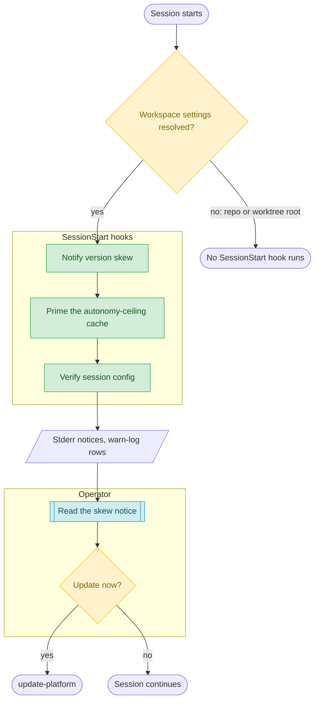

# Verify the session setup at session start

## Summary

When a session starts and resolves the workspace settings surface, three SessionStart hooks run in order: the
version-skew notifier, the autonomy-ceiling cache primer (a control-layer hook), and the session-config verifier.
None can block the session — a SessionStart hook's non-zero exit renders a notice and the session proceeds — so the
sub-process ends with the session running and, at most, two stderr notices: a version-skew line pointing at
[`update.sh`](/update.sh), and a model/effort drift finding. The skew line is the decision point: the operator either runs the
update sub-process or carries on. The registration lives only on the workspace-scope settings file, so a session
rooted in the repository or a worktree loads none of these hooks.

## Entry and exit

| Side | Criteria | Source |
|---|---|---|
| Entry | A session starts with a project root that resolves `<workspace>/.claude/settings.json`, rendered from the template at install and re-rendered by `update.sh` Phase 5d; the SessionStart object is not re-homed to user scope | [template](/core/settings.json.template#L221)<!-- source-anchor: line=221; fp=ed972ee50d098f10 -->; [UPDATE.md](/docs/UPDATE.md#L113)<!-- source-anchor: line=113; fp=592bd8f68747bde9 --> |
| Exit | The session is running; each hook exited 0 (warn mode) with its notice written to stderr, or silently; a skew notice, when present, names the deployed and latest versions and `./update.sh` | [skew hook](/core/hooks/notify-version-skew.sh#L106)<!-- source-anchor: line=106; fp=93b8de1c25bf264b -->; [verifier](/core/hooks/verify-session-config.sh#L235)<!-- source-anchor: line=235; fp=1fda90b8f0304480 --> |

## Flow

## Activities

| Activity | Primary actor | Purpose | Page |
|---|---|---|---|
| Notify the operator of version skew | hook:notify-version-skew | Compare the deployed `.version` to the latest published release and print the update prompt | [notify-version-skew](notify-version-skew.md) |
| Verify the session's model and effort posture | hook:verify-session-config | Report runtime drift from the canonical `[spoke_runtime]` directive as an advisory | [verify-session-config](verify-session-config.md) |

## Controls

| Control | Source | Enforcement class | Surface | Applies to |
|---|---|---|---|---|
| SessionStart runs the skew notifier on every session that loads the workspace settings | `core/settings.json.template` (C-108) | code-warn | hook | notify-version-skew |
| SessionStart runs the session-config verifier on the same surface | `core/settings.json.template` (C-110) | code-off | hook | verify-session-config |
| A version behind the latest release is reported, never applied | `core/hooks/notify-version-skew.sh` (C-079) | code-warn | hook | notify-version-skew |
| A model outside the accept set, an effort other than `max`, or an absent payload model is reported | `core/hooks/verify-session-config.sh` (C-074 to C-076) | code-off | hook | verify-session-config |
| The PreToolUse wiring re-home to user scope is a one-time operator act that no flow performs; SessionStart and Stop stay workspace-scope | `docs/UPDATE.md`, "Re-home the PreToolUse hook wiring"; the template's `_comment` key | prose-only | — | both activities |
| Notices go to stderr, never stdout, so they do not enter the model's context | `core/hooks/verify-session-config.sh`, the header comment | prose-only | — | verify-session-config |

## Evidence

| Lens | Source | Observation | Label |
|---|---|---|---|
| designed | [`core/settings.json.template`](/core/settings.json.template), the SessionStart and Stop blocks | three SessionStart hooks in order; the Stop hook is a fourth registration (the session-retro trigger, [run-session-retro](run-session-retro.md)); the template comment fixes the scope split | [SOURCE] |
| designed | [`docs/UPDATE.md`](/docs/UPDATE.md), "Version-skew notification" and the troubleshooting entry on a missing notice | the skew notice's semantics and its four silent-failure causes (unregistered, `gh` unauthenticated, handle unset, no network) | [SOURCE] |
| built | [`controls-register.tsv`](/core/process-catalog/definitions/controls-register.tsv), C-074, C-075, C-076, C-079, C-108, C-110; [`docs/scripts/setup-workspace.sh`](/docs/scripts/setup-workspace.sh), `install_hooks` | the register classes the notifier and its registration `code-warn`, and the verifier's rules and its registration `code-off`; the installer has no call site that lays down the verifier's mode file, and its comment says so | [SOURCE] |
| executed | no measure — the verifier's findings go to the warn log, which no measure in the measures register reads. | The page says nothing of which rule fires or how often | [SOURCE] |
| executed | held local — the notifier's notice is one stderr line inside a session, so what would show a firing is the store of sessions on an install. | The notifier writes to stderr and to no log; the page says nothing of how often it fires | [SOURCE] |

## Navigation

<!-- nav:begin -->
Up: [install-or-update-workspace](install-or-update-workspace.md) · Previous: [deploy-merged-changes](deploy-merged-changes.md) · Down: [notify-version-skew](notify-version-skew.md) · [verify-session-config](verify-session-config.md)
<!-- nav:end -->

## Sources

- [`core/settings.json.template`](/core/settings.json.template) — the SessionStart and Stop registrations and the scope comment
- [`core/hooks/notify-version-skew.sh`](/core/hooks/notify-version-skew.sh), [`core/hooks/verify-session-config.sh`](/core/hooks/verify-session-config.sh) — the two hooks
- [`docs/UPDATE.md`](/docs/UPDATE.md) — re-home, skew notice, troubleshooting
- [`update.sh`](/update.sh), [`docs/scripts/setup-workspace.sh`](/docs/scripts/setup-workspace.sh) — the updater that re-renders the settings file, and the installer's hook install
- [`core/process-catalog/definitions/controls-register.tsv`](/core/process-catalog/definitions/controls-register.tsv) — C-074, C-075, C-076, C-079, C-108, C-110
