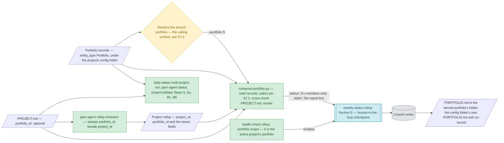

<!-- reference-durability: allow-link -->

# Portfolio Write-Back Contract — G7 Project-to-Portfolio Rollup

**Status:** Canonical (Stage 6 Engineering until merged)
**Owner:** `core/standards/portfolio-writeback-contract.md`
**Introduced:** release `pda-rollup-and-portfolio` — the G7 project-to-portfolio rollup-contract work item (project-data-architecture initiative, portfolio write-back layer).
**Architectural basis:** ADR-019 (compose-not-absorb) + the entity-roster freeze in [`../disciplines/project-entity-model.md`](../disciplines/project-entity-model.md) §4 (re-frozen at **19 entities** via ADR-044). The per-project rollup is a **COMPOSED read-surface over existing entities — NOT a roster entity**: the roster is frozen at 19 and this contract adds none. Each contract field READS its source entity and references that authoritative value; no field owns or duplicates one.

---

## §1 Purpose & Boundary

Project → portfolio rollup was implicit: `PORTFOLIO.md` was hand-synthesized by `weekly-status-rollup` Section 6 with no field contract, so skill-output drift propagated silently and the dashboard could read Green over a failing subsystem. This contract closes that gap. It defines **one** per-project publishing schema — a fixed set of fields, each typed, each with a cadence, each sourced from a frozen entity — so the deterministic composer renders `PORTFOLIO.md` sections **from fields**, not from agent-synthesized prose.

**Staging-only boundary (load-bearing).** This contract **STAGES composed content for the Cowork `PORTFOLIO.md` writer — it NEVER authorizes a Claude-side write into `projects/`.** `PORTFOLIO.md` is a Layer-2, Cowork-owned artifact ([`../rules/operations-bridge.md`](../rules/operations-bridge.md): Claude Code does not write any Layer-2 file). Every section this contract defines is composed content routed through `weekly-status-rollup` Section 6's existing human-in-the-loop checkpoint. No producer of this contract has an output path that resolves into `projects/`.

**Roster-rule exemption (explicit).** The per-project rollup record is a composed read-surface, so it is **exempt from `V-CORE-02`** (`entity_type` ∈ the frozen roster): its `entity_type: "Project Rollup (composed)"` is deliberately non-roster and is the composer's **discovery key** (`../deploy/tools/compose-portfolio.py`), not a roster claim — a roster-legal value would make the composer discover **zero** rollups. It is likewise exempt from **`V-CORE-03`/`V-CORE-03b`** (`lifecycle_state`) and **`V-CORE-06`** (`created_date`): the record carries no lifecycle of its own, and its freshness is carried by `last_published` per §3. No other Core rule is waived. **Honest enforcement status:** these rules are today *declared* L1-blocking in [`../schemas/entity-field-schemas.md`](../schemas/entity-field-schemas.md) §3.0 but are **mechanically unenforced** — the entire `V-CORE` family has **zero** executable references across the corpus's `.py`/`.sh` files, and the only executable reader of `entity_type` is the composer, which uses it as a discovery key rather than a validator. This exemption is therefore **governance-correctness**: it is stated so that a future mechanization does not fail a record the contract deliberately excludes. It closes no live enforcement gap and must not be cited as though it does.

**What this contract owns vs. what parameterizes it.** This contract owns the field set (§2), the `last_published` freshness field and the `[STALE]` render marker and the staleness **anchor definition** (§3), the `PORTFOLIO.md` section-schema map (§4), and the portfolio-tier selection rule with the location of each portfolio's composed file (§7). The portfolio health-score work item supplies the threshold **values** that parameterize the one staleness mechanism in §3 — it introduces no second freshness field. The deterministic composer is the execution engine that renders §4 from §2; this contract is its input schema.

## §2 Per-project publishing schema (7 fields)

The per-project rollup entity (`[Project]_Rollup.md`, templated at [`../../operations/templates/project-rollup-template.md`](../../operations/templates/project-rollup-template.md)) carries exactly these seven fields. `Req` = required/optional. `Cadence` = the per-field refresh rhythm, drawn from the existing operational-artifact cadence vocabulary {daily, weekly, on-event}. `Source entity` names the frozen entity the field READS (entity numbers per [`../disciplines/project-entity-model.md`](../disciplines/project-entity-model.md) §4).

| Field | Type | Req | Cadence | Source entity (READS) | Notes |
|---|---|---|---|---|---|
| `status` | enum {`green`, `yellow`, `red`} (RAG) | Required | weekly (published) · daily (refreshed) | Project (entity 1) — `health_rag`; ppm-agent derives + maintains | worst-component dominance — the existing Section-1 health rule + the watermelon gate (`weekly-status-rollup` § Watermelon Scan); a subsystem `red` cannot roll up to portfolio `green`. Source is the **derived projection**, not a self-reported value: the bands and the transparent worst-component roll-up rule are owned by `comms-writer/references/channel-formats.md` § RAG Threshold Standards (ADR-065, retained owner), the metric→band **index** is `weekly-status-rollup/references/metric-registry.md` § Project Metrics, and composition is executed in `weekly-status-rollup` Section 1. `health_derived_date` is `health_rag`'s required companion stamp (V-PRJ-11) |
| `top_risks[]` | array&lt;{`risk`, `owner`, `mitigation`}&gt;, ≤ 5 | Required | weekly | RAID Item (entity 6) — `impact` / `owner_person_id` / `action_plan`; tracker-manager maintains | passive-voice-free triples (platform guardrail); `impact` is the field the portfolio-rollup query keys on |
| `key_dependencies[]` | array&lt;{`from`, `to`, `state`}&gt; | Required | weekly · on-event (break) | Cross-Project Dependency / XPD (entity 15) — `from_entity_ref` / `to_entity_ref` / `lifecycle_state` (`open → satisfied \| broken \| waived`); ppm-agent maintains | — |
| `capacity_signal` | {`utilization`: float, `gap_rag`: enum} | Required | weekly | Resource (entity 8) — `allocation_pct`; delivery-engine maintains | the effective-capacity + Demand-Supply-Gap synthesis is owned by `weekly-status-rollup` §7.5 + `capacity-model.md` §1/§9 — **cite that synthesis by reference; do not re-derive it** |
| `milestone_delta` | {`next_milestone`, `target`, `actual`?, `state`} | Required | weekly · on-event (state change) | Milestone (entity 2) — `milestone_name` / `target_date` / `actual_date` / `lifecycle_state` (`planned → in-progress → completed \| cancelled`); delivery-engine maintains | — |
| `cross_project_conflicts[]` | array&lt;{`conflict`, `projects_affected[]`, `owner`, `mitigation`}&gt; | Required | weekly · on-event (detect) | Cross-Project Resource Conflict / XRC (entity 16) — `conflict_id` / `competing_project_ids` / `person_id` (`detected → acknowledged → resolved`); delivery-engine maintains | makes §4 S6 (Cross-Project RAID) and S8 (Resource Conflicts) **fully contract-driven** — the composer renders them from this field, not from agent-synthesized prose |
| `last_published` | ISO 8601 datetime | Required | on every publish | rollup meta | the **single** freshness field — drives the `[STALE]` marker per §3; no parallel freshness field exists |

**Join keys (outside the seven).** Beside the seven contract fields the rollup carries two join keys, neither of which is a contract field: `project_id`, its join key to its Project record, and — when its Project names one — `portfolio_id`, the same value as that Project's `portfolio_id` (`../schemas/entity-field-schemas.md` § Project (PRJ)), the key §7 selects on. A project that names no portfolio gets **no** `portfolio_id` line: the key is never written empty, and never carries an inline comment (the shared frontmatter reader keeps a trailing `# …` as part of the value). Neither key counts toward the seven.

**Absent-source behaviour for `status` (no silent default).** `health_rag` is an **optional** Project field while the rollup's `status` is **required**. When a project carries no `health_rag`, `ppm-agent` **emits no rollup for that project** — an honest coverage gap, mirroring the composer's existing `Unclassified` honesty pattern for an unset `investment_class` (§4 S4). It **must never default to `green`**: a defaulted health value is indistinguishable from a derived one at the render surface, which is precisely the watermelon failure the watermelon gate (`weekly-status-rollup` § Watermelon Scan) exists to prevent.

**`completeness_score` is deliberately OMITTED.** No live producer emits it (0 producers / 0 consumers at authoring). A required field nothing populates is a spec-vs-reality defect; an optional stub invites divergence. The field is added atomically with its producer when a producer ships — not carried as an empty contract slot now.

**Drift detection.** A rollup field whose value type deviates from the type declared above is flagged for repair. The rollup is a composed surface: a field is valid only when it reads its named source entity's authoritative value.

## §3 The `[STALE]` staleness mechanism — pinned anchor

**Anchor (pinned by this contract).** A rollup's staleness age is measured as:

> **age = `today − last_published`, in BUSINESS days.**

The anchor is `today` (the current date at composition), **not** `max(last_published)` across projects. The fixed-`--as-of` form is scoped **only** to the composer's `--self-test` fixture (which pins a deterministic date so the fixture output is reproducible); in production the composer is invoked with **`--as-of=today`**. `weekly-status-rollup` Section 6 passes `--as-of=today` and, on an install that holds a Portfolio record, `--portfolio <served portfolio_id>` at the projects root (§7).

**Unit is business days** (the calendar-vs-business-day ambiguity is resolved here to business days, uniformly):

| Threshold | Effect |
|---|---|
| age `> 3 business days` | render `[STALE]` inline next to the aged field in the composed `PORTFOLIO.md` section |
| age `> 5 business days` | auto-degrade the field (the health-score layer treats an auto-degraded field as not-Green) |

This contract owns the `last_published` field, the `[STALE]` render marker, and the anchor definition above. The portfolio health-score work item supplies the two threshold **values** (`3` and `5` business days) that parameterize this one mechanism — it does **not** invent a second freshness field.

**Idempotency.** Because age anchors on `today − last_published`, re-running the composer with the same `--as-of` over an unchanged rollup produces byte-identical output — the freshness computation is a pure function of `(as_of, last_published)`.

## §4 PORTFOLIO.md section-schema map (Part A — the shared composition anchor)

The deterministic composer renders these `PORTFOLIO.md` sections from the §2 fields. `[EXISTING]` = a section `weekly-status-rollup` already writes (extend in place); `[NEW]` = net-new. This is the ONE section schema the four portfolio write-back work items in this release compose — the composer engine, the health score, and the risk profile each render or populate a slice of it.

| Sec | `PORTFOLIO.md` section | State | §2 contract field(s) | Backing entity |
|---|---|---|---|---|
| **S1** | `## Portfolio Health Summary` (per-project row: Phase · Health RAG · Critical-Path · Go-Live · **Last-Validated**) | EXISTING → extend | `status`, `milestone_delta`, `last_published` | Project (1), Milestone (2) |
| **S2** | per-project `### Health Indicators` (Schedule / Scope / Quality / Stakeholders / Integration, **each resolved independently**, in a `Dimension · Status · Source` table; the composed roll-up line beneath the table carries `[STALE]` when aged, while a dimension cell rendering `UNSOURCED` carries no marker — §4.1 R2) | EXISTING | — (the five dimensions are derivation **inputs** to `health_rag`, not a §2 contract field; indexed by `weekly-status-rollup/references/metric-registry.md` § Project Metrics under a **non-1:1** mapping — Quality composes Risk + Integration Risk, and Stakeholders is an optional `UNSOURCED-DOMAIN` row that may not exist). Per-dimension backing is governed in **§4.1**; the composer resolves each dimension independently and renders `UNSOURCED` for any dimension no §2 field backs | Project (1) |
| **S3** | `## Capacity Dashboard` (per-project utilization + portfolio demand-supply gap RAG) | NEW | `capacity_signal` | Resource (8) |
| **S4** | `## Portfolio R-G-T Allocation` (Run / Grow / Transform shares; `Unclassified` coverage gap) | NEW | — (reads `PROJECT.md` `investment_class`) | Project (1) |
| **S5** | per-project `### Top Risks` (≤ 5 rows: risk · owner · mitigation) | EXISTING → extend | `top_risks[]` | RAID Item (6) |
| **S6** | `## Cross-Project RAID` (aggregated 6-column shell: `Type · Item · Owner · Mitigation · Source-Tier · Projects-Affected`; `Type` = source leg {Risk, Dependency, Conflict}, `Source-Tier` = `Project` for the RAID leg · `Portfolio` for XPD/XRC; a risk-bearing row missing an owner/mitigation renders an inline `[DRIFT: incomplete risk record]` repair flag) | NEW | `top_risks[]` + `key_dependencies[]` + `cross_project_conflicts[]` | RAID Item (6) + XPD (15) + XRC (16) |
| **S7** | `## Cross-Project Dependencies` | EXISTING | `key_dependencies[]` | XPD (15) |
| **S8** | per-project `### Resource Conflicts` | EXISTING | `cross_project_conflicts[]` | XRC (16) |
| **meta** | `Last Updated` (portfolio-level) + inline `[STALE]` markers | mechanism | `last_published` + per-field cadence | — |

**Coherence rules (bind every producer of this schema):**
- **One staleness mechanism.** §3 is the sole freshness apparatus: one `last_published` field, one `[STALE]` marker, one anchor. Threshold values parameterize it; they do not fork it.
- **One cross-project risk surface.** S6 is a single aggregated section. S5 (per-project) and S6 (cross-project) are distinct scopes of one risk model — composed, never duplicated. `cross_project_conflicts[]` makes S6/S8 render deterministically from fields.
- **Staging-only.** Every section is composed content staged via `weekly-status-rollup` Section 6's human-in-the-loop checkpoint (§1 boundary). No producer writes `projects/`.
- **One served portfolio per output.** Every section is composed from the served portfolio's member rollups only (§7); the section schema is identical for every portfolio, and the composed body never names the portfolio it serves.

### §4.1 S2 Health-Indicator dimension → metric mapping (governed)

The five S2 dimensions are derivation **inputs** to `health_rag`, not §2 contract fields. This table is the single governed statement of which metric backs which dimension and which §2 field, if any, carries it. It is the SSOT the composer's `HEALTH_DIMENSIONS` table points at; the composer holds no second copy of the mapping's meaning.

| Dimension | Backing metric (and the source that metric reads) | §2 field carrying it | Renders today |
|---|---|---|---|
| Schedule | Schedule Performance Index (SPI) — `PROJECT.md` milestone %-complete + plan baseline (EVM tracker) | none | `UNSOURCED` |
| Scope | Scope — `PROJECT.md` + change log | none | `UNSOURCED` |
| Quality | **composes two metrics** — Risk (RAID Log) **+** Integration Risk (`PROJECT.md` Health Indicators + technical-analyst findings) | none — and `top_risks[]` cannot substitute: its type is `{risk, owner, mitigation}` with no severity, while the Risk band keys on *any critical risk unmitigated OR ≥3 high risks* | `UNSOURCED` |
| Stakeholders | Stakeholder Engagement — **optional**, unsourced at the metric registry, and no row for it exists today | none | `UNSOURCED` |
| Integration | Integration Risk — unsourced at the metric registry (`PROJECT.md` Health Indicators + technical-analyst findings) | none | `UNSOURCED` |

Two mappings are deliberately **not 1:1** and both are stated rather than smoothed over: **Quality** composes two metrics into one dimension, and **Stakeholders** has no metric row at all. A third asymmetry follows from the same table — Integration Risk backs two dimensions, while the Budget (CPI) metric backs none.

**R1 — A dimension renders its own resolved value or `UNSOURCED`.** It never borrows another dimension's value and never borrows the composed project RAG. Five dimension labels carrying one scalar present a single signal as five corroborating ones — the watermelon shape the watermelon gate (`weekly-status-rollup` § Watermelon Scan) and this contract exist to prevent.

**R2 — `UNSOURCED` carries no `[STALE]` marker.** The §3 freshness marker qualifies a value; a cell reporting the absence of a value has nothing for it to qualify. The composed project RAG rendered alongside the table does carry its marker, because it is a real value. This is why the S2 row above scopes the marker to the roll-up line rather than to the dimension cells: with every dimension unbacked, no dimension cell can carry `[STALE]` at all, and a schema row claiming otherwise would assert something the composer cannot produce.

**R3 — Backing arrives with its producer.** A per-dimension field enters §2 atomically with the producer that emits it, exactly as §2 states for `completeness_score`; it is never added as an empty slot so this table can read as delivered.

## §5 Emit / consume wiring

**Emit (ppm-agent).** `ppm-agent` maintains the Project entity, runs the daily processing cycle, and is the emitter for entity-lifecycle transitions. On its scheduled cadence it emits / refreshes the per-project rollup entity per this contract — **READING** each source entity (§2) and staging its value into the rollup field, never re-deriving an authoritative value the source entity owns. The emission rides the existing `TRACKER_UPDATE` carrier (`../../operations/skills/ppm-agent/SKILL.md` § 8.7 / § 8.8) — no new mechanism. The evidence gate binds unchanged: a source value that is `[ASSUMPTION – CONFIRM]` is surfaced as a "Decisions needed" line, not emitted.

**Consume (weekly-status-rollup).** `weekly-status-rollup` Section 6 CONSUMES the per-project rollup entity and composes the `PORTFOLIO.md` sections (§4) from the contract fields rather than re-deriving each field. In production the deterministic composer is invoked with `--as-of=today` (§3) and, on an install that holds a Portfolio record, `--portfolio <served portfolio_id>` (§7), honors the `[STALE]` marker, and stages the result for the Cowork writer at the Section-6 human checkpoint.

## §6 Cutover & provenance

**Cutover discipline.** Applies to all portfolio write-back composition going forward. The contract is additive — it formalizes the schema the prior hand-synthesis already read; no data migration is required (the `PORTFOLIO.md` restructure replaces handwritten content in place).

**Reversibility:** MODERATE / Confidence HIGH — the contract, the template, and the skill wiring are git-revertable up to the release gate; the `PORTFOLIO.md` restructure is cosmetic (replaces handwritten content, no stored data lost).

## §7 Portfolio scoping

**Scope.** This section is the one portfolio-tier selection rule. Every portfolio-level surface — a surface that chooses which projects to compose, report, validate, register or close for a portfolio — selects its project set by this rule and cites this heading rather than restating it: the deterministic composer; `weekly-status-rollup` (the roll-up and Section 6); `daily-status` (a multi-project run); `health-check` `rollup --scope portfolio`; `ppm-agent` (a status answer and its rollup emission); and `project-initiator` (Mode A registration and validation, Mode B closure). It is a **read and selection rule**: it authors no Portfolio or Project record and gives no producer an output path into the operations tree (§1).

**Where it binds.** The composer applies this section in code, and only when it runs: production composition is operator-driven through `weekly-status-rollup` Section 6. Every other surface applies it in its own steps, so the surfaces' own text is this section's primary control and the composer's self-test is its executable half.

### §7.1 Inputs

- **Portfolio records.** A Portfolio record (entity 13) is a markdown file directly in `projects/_config/`, or in one folder below it whose name is a kebab slug, outside dot-leading paths, whose frontmatter `entity_type` is exactly `Portfolio`. The config folder's own `releases/` folder is not a record location, and a file nested deeper than one folder is not read (its portfolio's projects then read as unresolved). Its key set is the one `../schemas/project-schema.md` § Entity-Seeding Protocol enumerates at its Portfolio-tier step; its physical form is stated in `../disciplines/project-entity-model.md` § Storage-Location Map. A record is located by that key and its `portfolio_id`, never by its filename or folder — with one narrow exception: **a composed `PORTFOLIO.md` is never a Portfolio record**, so a file of that name that carries `entity_type: Portfolio` is a configuration error, and a record always lives in its own file. Its recommended home is its portfolio's folder (§7.5). Only a record whose `lifecycle_state` is `active` is served.
- **The portfolio count.** The install's active portfolios are the **distinct** `portfolio_id` values of its active records. Two active records with one `portfolio_id` count once and are reported to the operator as a duplicate (V-PORT-02). One `portfolio_id` held by records in different states — an active record and an archived one — is a configuration error, and so is a `portfolio_id` that names the config folder's own `releases/` folder.
- **Membership key.** A Project's optional `portfolio_id` (`../schemas/entity-field-schemas.md` § Project (PRJ)); the rollup carries the same value as its `portfolio_id` join key (§2). Both are read with one test, the kebab slug `^[a-z0-9][a-z0-9-]*$`. A `PROJECT.md` value that fails it — a trailing `# …` included — is **polluted**: the project is held out of every output and reported as such until the line is corrected. An empty `PROJECT.md` value reads as absent.

### §7.2 Membership

| Active portfolios | The project's `portfolio_id` | In the output of | Listed to the operator as |
|---|---|---|---|
| none | any | — unscoped: every active project, keyed or not, exactly as before — **except** that when the projects' `portfolio_id` values (the composer reads its rollups') name two or more portfolios, the run stops and names the Portfolio records to create — the remedy, since no scoped run is possible without them | a present key: unresolved |
| one (P) | absent, or P | P | — |
| one or more | another active portfolio Q | Q only | — |
| two or more | absent | no portfolio | unassigned |
| one or more | the id of an archived record | no portfolio | names an inactive Portfolio record |
| one or more | an id no record carries | no portfolio | unresolved `portfolio_id` (V-PRJ-05) |
| any | present but empty, not a kebab slug `^[a-z0-9][a-z0-9-]*$`, or written under a near-miss key name | the run halts — join-key drift | the drift line |

A trailing `# …` on the `portfolio_id:` line is content to the shared frontmatter reader, so it fails the slug test. An empty key is never read as "no portfolio" — omit the key instead.

**Why a key naming no record is excluded even with one active portfolio.** It may name a second portfolio whose record does not exist yet. Excluding and listing it keeps that portfolio's projects out of the first portfolio's output while an install moves from one portfolio to two.

- **Nothing stops for a per-project state.** An unassigned, unresolved or inactive project, or one held for a polluted `PROJECT.md` key, is excluded from every output and listed to the operator; the run continues.
- **A rollup and its own `PROJECT.md` agree.** When a rollup's `portfolio_id` and its own `PROJECT.md`'s place the project in different portfolios — a project with no key, on an install with one active portfolio, is in that portfolio — the rollup is **held** out of every output until it is re-emitted, and reported. The composer applies this whenever its root holds that `PROJECT.md`.
- **Moving a project** to another portfolio is two acts, never an edit of `portfolio_id` alone: the project's row is closed out of the old portfolio's composed file and registered in the new one's (`project-initiator`), and its rollup is re-emitted. Until it is, the rollup is held.

### §7.3 The served portfolio

A run of a portfolio-level surface serves exactly one portfolio, **S** — or, with no active portfolio, runs unscoped. S is, in order: the portfolio the request names; else the portfolio of the project the run is anchored on; else, with one active portfolio, that portfolio. With two or more active portfolios, no portfolio named and no anchoring project, an interactive run asks which, listing them; a scheduled run produces one output per active portfolio.

A surface whose output stages in its anchor project (`health-check`) serves the anchor's portfolio and refuses a request that names another. When the named portfolio is not active, or the anchor project is unassigned, unresolved or inactive, the surface stops and reports it; it never falls back to serving another portfolio.

The calling surface passes S to the composer (`--portfolio`). The composer reads the Portfolio records under `<root>/_config/` itself and refuses a run that names a portfolio at a root holding no active record, or names none at a root holding one — so narrowing its `--root` cannot change membership.

### §7.4 Fail closed; report off the stakeholder surface

- No project enters a portfolio's output on a guess.
- **The report line.** Each surface states, in its own run summary or approval checkpoint, `Portfolio: <served portfolio_id, or unscoped> — unassigned: <project ids or none>; unresolved portfolio_id: <project ids or none>`. The composer writes the same leading fields to standard error, with what it alone can compute besides — the member count, the active Portfolio records, inactive, held and polluted-key projects, another portfolio's projects (counted, never named), and contract drift outside the served portfolio. The line is **never** in the stakeholder-facing output: the composed body is selection-only and names no portfolio, so a single-portfolio install composes the bytes it composed before.
- **Drift.** Join-key drift in any rollup halts every portfolio's run, because membership is undecidable. Contract-field drift halts only the run of the portfolio its rollup belongs to, and is counted, not named, in every other run.
- **Cross-portfolio references.** In S's output, a member's cross-project reference (`key_dependencies[]` `from` / `to`; `cross_project_conflicts[]` `projects_affected`, a list or a comma-separated value) to a rollup the composer discovered outside S renders `[OTHER PORTFOLIO]` in its place — whether the reference is that project's `project_id`, an entity id that `project_id` prefixes (`<project_id>-…`), or exactly its `PROJECT.md` `id`. A `PROJECT.md` `id` matches exactly, never as a prefix, so a portfolio-neutral id that merely shares its first words is not rewritten; where a prefix matches both a member's `project_id` and another's, the longer one decides. This is defense in depth, not the selection guarantee: an identifier the composer did not discover renders unchanged, and free text is never rewritten.

### §7.5 Where each portfolio's composed output lives

| Install | Composed file |
|---|---|
| no active Portfolio record | `projects/_config/PORTFOLIO.md` |
| one or more active portfolios | `projects/_config/<portfolio_id>/PORTFOLIO.md`, one per active portfolio |

- **The folder** is the portfolio's output home, named by its `portfolio_id` (never by the record's `id`). It does not classify: membership stays by `portfolio_id`. A `portfolio_id` equal to an existing folder under `projects/_config/` that is not that portfolio's is a configuration error; the config folder's own `releases/` is reserved, and the composer refuses that id.
- **The folder file exists from the moment a portfolio is active.** A Portfolio record is seeded together with its folder and an empty composed file in the section shape (project-initiator creates one in the same shape on demand), so each active portfolio has exactly one composed file — which is what the configuration reader's portfolio rung counts.
- **Migration.** When an install gains its first active Portfolio record, `projects/_config/PORTFOLIO.md` is moved, whole and with its frontmatter, into that portfolio's folder. While it remains beside an active record, every portfolio-level surface stops and names the move — the composer exits 2 — and no surface composes into, registers in, or creates a per-portfolio file. An archived portfolio's folder is left as it is and read by no surface.
- **Staging.** A portfolio-level artifact a surface persists to `08-Generated/` keeps its name and is staged under a project that belongs to the served portfolio, for every portfolio alike — never under a project of another portfolio.

### §7.6 Data flow
<!-- design-artifact: flow-class=data-flow; name=portfolio-scoping; depicts=core/standards/portfolio-writeback-contract.md,core/deploy/tools/compose-portfolio.py,operations/skills/weekly-status-rollup/SKILL.md,operations/skills/ppm-agent/SKILL.md -->

## Provenance

The G7 project-to-portfolio rollup-contract work item in the `pda-rollup-and-portfolio` release (project-data-architecture initiative, portfolio write-back layer). Composes: the deterministic `PORTFOLIO.md` composer work item (renders §4 from §2), the portfolio health-score work item (supplies the §3 threshold values + the freshness hard-gate), the portfolio risk-profile work item (populates S6 aggregation), and the operational tier-taxonomy work item (the `project_id` kebab-case `*_id` convention the rollup entity conforms to).
